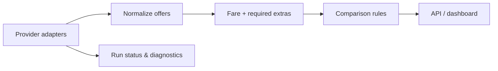

# FairFlight — compare the cost, not the headline fare

**Question:** How do we compare travel offers that package required extras differently?

FairFlight is a personal API and dashboard prototype designed to compare round trips, combinations of one-way flights, airlines, and alternative airports using a more complete trip-cost model.

## Logical data flow

*Illustrative overview; provider-specific credentials and integrations are not published.*

## What makes it an engineering problem?

- Different providers describe offers with different fields and assumptions.
- The cheapest headline fare may not be the cheapest viable itinerary.
- Missing baggage or compulsory fees should be made explicit rather than silently treated as zero.
- Upstream API failures need timeouts, retry policy, and a visible data-quality state.
- Offline, deterministic mock sources make it possible to test the comparison logic without live credentials.

**Stack explored:** Python, FastAPI, Streamlit, Docker, external flight-data provider adapters.

**Scope:** prototype. Live-price coverage and booking capabilities are not claimed.

[Back to showcase](README.md)
