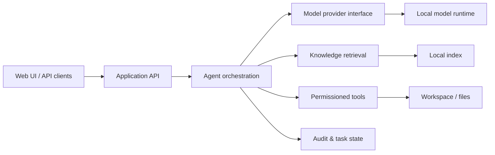

# Forge AI — a local-first assistant

**Question:** How do we make an AI assistant useful across everyday technical tasks without giving it uncontrolled access to the machine?

Forge AI is a personal, local-first assistant project. The private implementation includes an API, web UI, model-provider abstraction, local knowledge indexing, memory-related components, and constrained workspace tooling.

## Conceptual architecture

*This is an illustrative logical map, not the exact private implementation.*

## Design choices worth discussing

- **Local-first by default:** useful for experimenting with local inference and keeping data in user-controlled environments.
- **Bounded access:** distinguish answering a question from acting on files or running commands.
- **Explicit memory:** separately manage conversational context, stored knowledge, and user-governed personal information.
- **Reviewable operations:** tool actions should have a visible purpose and failure state.
- **Provider separation:** model execution is an interface, not the entire product.

## Interesting failure modes

What if retrieval returns stale knowledge? What if the model proposes an action outside its permissions? What if a task partially succeeds? These are application-engineering problems, not merely prompt-engineering problems.

**Stack explored:** Python, FastAPI, Next.js, TypeScript, Docker, Ollama, retrieval / embeddings.

**Status:** personal project; no claim of unsupervised production reliability.

[Back to showcase](README.md)
