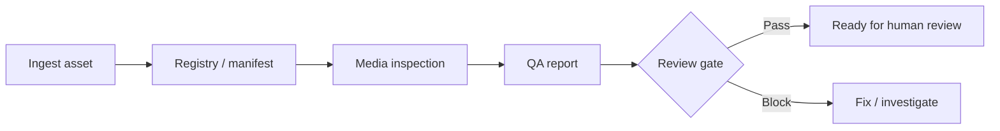

# Neyra OS — shipping media requires checks, too

**Question:** How do we stop a visually plausible but technically broken asset from reaching a publishing workflow?

Neyra OS is a local asset-management and media-quality project with an offline verification workflow. It works with generated media fixtures and metadata without requiring live publishing access.

## Illustrative QA gate

*PASS in a technical media check does not automatically authorize publication.*

## Useful engineering details

- Asset identity and associated metadata need a consistent registry.
- Dimensions, aspect ratio, streams, and audio characteristics can be checked programmatically.
- Test fixtures should be synthetic and safe to distribute.
- A publishing state is not the same thing as a successful file export.
- A failing check should produce a report an operator can act on.

**Stack explored:** Python, FFmpeg/ffprobe, SQLite, image/video QA, offline tests.

**Scope:** local QA tooling; no claim of autonomous external publishing.

[Back to showcase](README.md)
