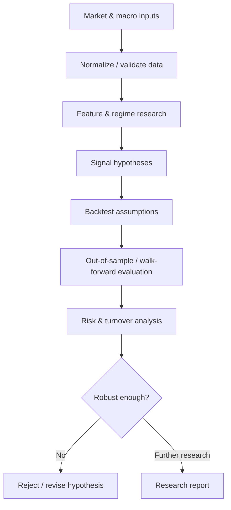

# Systematic trading research — evidence over equity curves

**Question:** How do we distinguish a plausible market hypothesis from a strategy that only works in hindsight?

My private research projects include a multi-source research platform and an adaptive cross-asset macro engine. Their focus is a repeatable loop from data ingestion to risk-aware evaluation, not a public claim of investment performance.

## Research loop

*Conceptual research workflow; not a published strategy or execution specification.*

## Engineering considerations

| Problem | Why it matters |
| --- | --- |
| Look-ahead bias | Future information can make a weak strategy appear convincing |
| Timestamp alignment | Cross-asset data does not arrive on the same calendar or cadence |
| Fees and slippage | Gross theoretical edge is not executable edge |
| Walk-forward validation | In-sample optimization is not generalization |
| Exposure and drawdown constraints | A signal is not a portfolio risk policy |
| Reproducibility | Identical inputs and assumptions should permit repeatable analysis |

A related private **triangular arbitrage scanner** uses bid/ask prices, fee/slippage assumptions, and minimum liquidity filters for paper simulation. It does **not** demonstrate profitable live trading.

**Stack explored:** Python, Pandas, FastAPI, PostgreSQL, TypeScript, market-data APIs, Docker.

**Scope:** research, simulation, and decision support. No verified trading returns are claimed here.

[Back to showcase](README.md)
